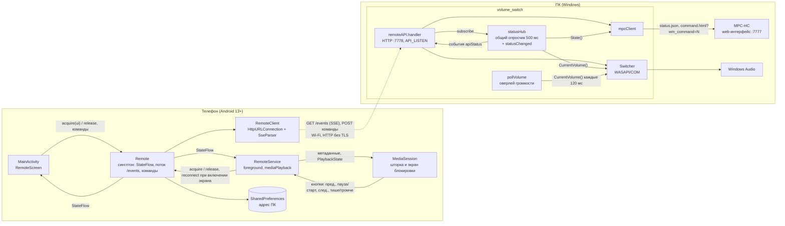
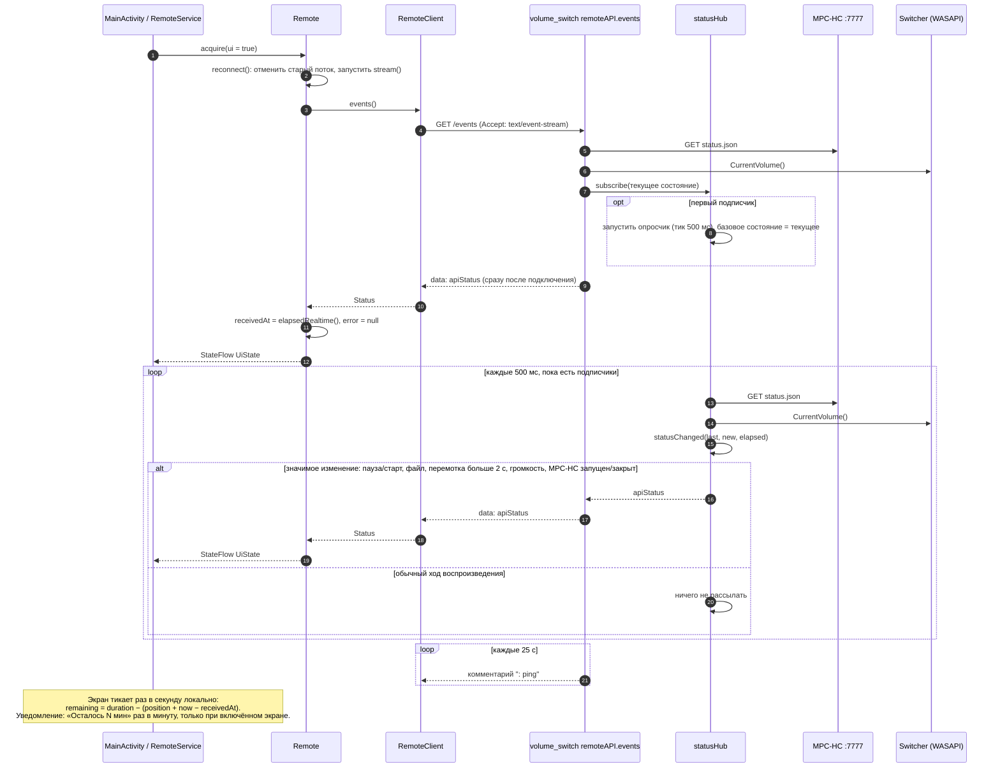
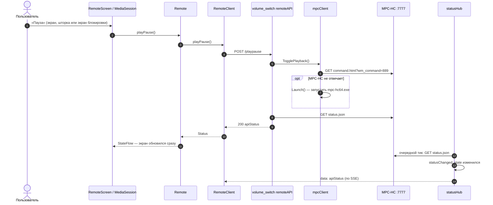
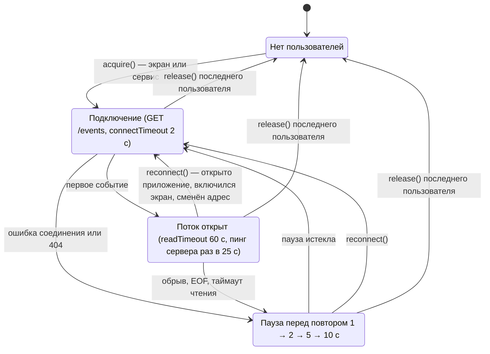
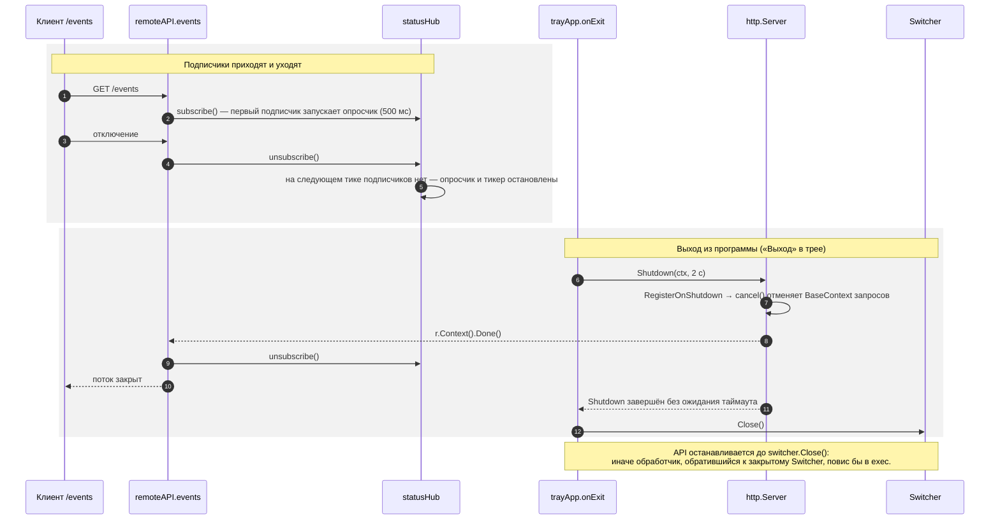

# Пульт MPC: взаимодействие телефона и ПК

Как Android-приложение «Пульт MPC» (`android/`) работает с volume_switch на ПК. Те же схемы в PlantUML — в [`plantuml/`](plantuml/).

Сопряжения в смысле обмена ключами нет: API без авторизации (решение владельца, см. `CLAUDE.md`). «Сопряжение» — это адрес ПК, введённый в приложении (`SharedPreferences`, по умолчанию `192.168.3.2:7778`), и открытый порт API на ПК (`API_LISTEN=:7778`, правило брандмауэра для частной сети).

## 1. Компоненты



## 2. Подключение и поток `/events` (SSE)

Телефон не опрашивает ПК: держит один поток `GET /events`, и ПК присылает состояние сам — сразу при подключении и затем только при значимых изменениях. Ход воспроизведения событий не порождает: оставшееся время телефон досчитывает сам от момента получения события.



## 3. Команда с телефона

Кнопка на экране, в шторке или на экране блокировки отправляет `POST`. Ответ — сразу новое `apiStatus`, поэтому экран обновляется без ожидания события; затем то же изменение приходит и по SSE. Так же за ~0,5 с доходят изменения, сделанные на самом ПК (F5-оверлей, клавиши, мышь в MPC-HC).



Остальные команды:

| Запрос | Что делает на ПК |
|--------|------------------|
| `POST /next`, `POST /prev` | `wm_command` 920/919 — следующий/предыдущий файл; 503, если MPC-HC не запущен |
| `POST /seek?position_ms=N`, `POST /seek?offset_ms=±N` | Позиция и длина — из `status.json`, затем `command.html?wm_command=-1&position=ЧЧ:ММ:СС.мс`; 409, если файл не открыт. Ползунок, кнопки ±10 с/±1 мин и полоса прогресса в шторке (`ACTION_SEEK_TO`). Телефон показывает новую позицию сразу, а при ошибке переподключает поток `/events` |
| `POST /volume/up`, `POST /volume/down` (`?step=N`) | Системная громкость через `Switcher.StepVolume`; на ПК показывается оверлей громкости. Сюда же — кнопки громкости телефона в открытом приложении и тише/громче в уведомлении |
| `POST /mpc/volume/up`, `POST /mpc/volume/down` | `wm_command` 907/908 — громкость самого MPC-HC |

## 4. Жизненный цикл потока на телефоне



Пользователи потока — `MainActivity` (`onStart`/`onStop`) и `RemoteService` (`onCreate`/`onDestroy`). Сервис останавливается сам, если 30 минут ничего не воспроизводится, и запускается снова при открытии приложения. Пауза перед повтором сбрасывается после первого полученного события; 404 означает старый volume_switch без `/events` — приложение просит его обновить.

## 5. Опросчик на ПК и остановка API



## 6. Просмотр фильма на планшете

Кнопка «Смотреть на этом устройстве» открывает `PlayerActivity`: планшет (или телефон) сам проигрывает тот же файл, что открыт в MPC-HC, — volume_switch отдаёт его по `GET /media` как есть, без перекодирования, с поддержкой HTTP Range для перемотки. Позиция, пауза и смена серии берутся из того же потока `/events`. Звук на планшете по умолчанию выключен (звук идёт с ПК), включается кнопкой.

```mermaid
sequenceDiagram
    autonumber
    actor user as Пользователь
    participant player as PlayerActivity (ExoPlayer)
    participant remote as Remote
    participant api as volume_switch remoteAPI
    participant mpchc as MPC-HC :7777
    participant file as Файл на диске ПК

    user->>player: «Смотреть на этом устройстве»
    player->>remote: acquire(ui = true)
    remote->>api: GET /events
    api-->>remote: data: apiStatus (file, position, state)
    remote-->>player: StateFlow
    player->>api: GET /media?file=имя (Range: bytes=…)
    api->>mpchc: GET status.json — путь текущего файла
    alt в MPC-HC уже другой файл
        api-->>player: 409 — переоткрыть по свежему состоянию
    else тот же файл
        api->>file: open + http.ServeContent
        api-->>player: 200/206 — файл как есть
    end
    player->>player: seek на позицию MPC-HC, playWhenReady = MPC-HC играет

    loop раз в секунду
        player->>player: syncAction(ожидаемая позиция, фактическая)
        alt расхождение больше 1,5 с (не чаще раза в 5 с; после события от ПК — сразу)
            player->>api: seek — новый GET /media с Range
        else расхождение больше 150 мс
            player->>player: скорость 0,95× или 1,05×
        else
            player->>player: скорость 1×
        end
    end

    api-->>remote: data: apiStatus (пауза, перемотка, следующая серия)
    remote-->>player: пауза/старт, seek, новый файл — новый /media
```

`/media` отдаёт только файл, открытый сейчас в MPC-HC (путь из `status.json`), — произвольные пути от клиента не принимаются. Видео декодирует сам планшет; дорожки, которые он не поддерживает (например, AC3-звук), ExoPlayer пропускает, а Dolby Vision при отсутствии декодера играется как обычный HEVC (`setEnableDecoderFallback`).
